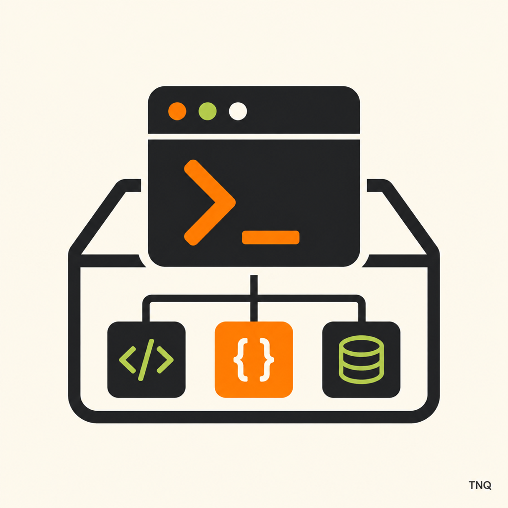

# Dev Sandbox

A lightweight, cross-platform desktop control center and launcher that automatically discovers and manages backend and frontend microservices within any Gradle, Maven, or Web project workspace.



## Overview

Modern software development often involves orchestrating multiple backend services, frontend applications, workers, and gateways locally. Manually launching each in separate terminal tabs, remembering port numbers, hunting down stale PIDs, and inspecting interleaved logs quickly becomes cumbersome.

**Dev Sandbox** eliminates the need for hard-coded service catalogs or complex scripts:
- **Zero Configuration Required**: Point Dev Sandbox to any repository root. It inspects your project layout and immediately detects runnable Gradle, Maven, and web applications.
- **Unified Control Plane**: Start, stop, restart, or configure environment variables and ports per service with a single click.
- **Interactive Multi-Service Console**: Filter logs by level (`INFO`, `WARN`, `ERROR`, `DEBUG`, `SYSTEM`), search with real-time navigation, copy active selections, or export logs to disk.
- **Port Conflict Adoption**: If a service port is already bound by an existing process from a previous session, Dev Sandbox can adopt and manage that PID safely without failing on startup.
- **Clean Lifecycle Management**: Gracefully terminates running processes and their child processes upon window close or project change.

---

## Features

- **Automated Discovery**:
  - **Gradle**: Detects Spring Boot modules (`bootRun`) and Gradle application plugins (`run`). Excludes non-runnable libraries.
  - **Maven**: Recursively parses `pom.xml` modules to identify Spring Boot Maven and Exec Maven applications.
  - **Web Applications**: Detects Node/web apps from `package.json` with `dev`, `start`, or `serve` scripts, automatically picking the matching package manager (`npm`, `pnpm`, `yarn`, or `bun`).
  - **Automatic Port Resolution**: Parses ports from Spring YAML/properties (`server.port`) and web configs (Vite, Angular, scripts).
- **Process Supervision**:
  - Health checks and status indicators (`STOPPED`, `STARTING`, `RUNNING`, `ERROR`, `STOPPING`).
  - Safe tree-process termination (`ProcessHandle.descendants()`) ensuring no rogue background processes are left behind.
  - Quick browser launch for active web apps and HTTP endpoints.
- **Lightweight & Standalone**:
  - Pure JDK implementation using Java Swing. No bulky native runtimes or heavyweight frameworks.
  - Runs on Java 21+.

---

## Getting Started

### Prerequisites

- **Java Development Kit (JDK)**: Java 21 or newer.
- Supported operating systems: macOS, Linux, Windows.

### Building & Running

Clone the repository and launch Dev Sandbox using the included Gradle wrapper:

```bash
git clone https://github.com/your-username/dev-sandbox.git
cd dev-sandbox
./gradlew run
# or use the startup script:
./scripts/start-dev-sandbox.sh [optional/path/to/project]
```

On Windows:
```cmd
gradlew.bat run
```

### Selecting a Project

1. Upon launch, Dev Sandbox prompts you to choose any Gradle or Maven project directory.
2. The selected project root is remembered across restarts.
3. You can click **Change Root** in the toolbar at any time to switch projects. Running processes are safely terminated before loading the new workspace.

You can also pass a project path directly as a command-line argument:
```bash
./gradlew run --args="/path/to/your/project"
```

### CLI Scan Mode (Headless)

To inspect detected modules in a workspace without launching the desktop GUI:

```bash
./gradlew run --args="--scan /path/to/your/project"
```

Example output:
```text
Project root: /Users/example/projects/my-microservices
JAVA_APP	account-service	8081	./gradlew :services:account-service:bootRun --no-daemon
JAVA_APP	payment-service	8082	./gradlew :services:payment-service:bootRun --no-daemon
WEB_APP 	admin-dashboard	3000	npm run dev
Detected modules: 3
```

---

## Distribution & Packaging

To create a standalone redistributable package:

```bash
./gradlew installDist
```

The executable script and application jars will be placed in `build/install/dev-sandbox/bin/dev-sandbox`.

You can also package zip or tar archives:
```bash
./gradlew distZip
./gradlew distTar
```

---

## Verification & Testing

Run all unit tests and coverage verification:

```bash
./gradlew check
```

To build the obfuscated production JAR:
```bash
./gradlew obfuscate
```

---

## Security & Code Protection

- **ProGuard Obfuscation**: Production builds automatically run bytecode obfuscation via ProGuard, renaming internal packages, classes, methods, and variables, as well as stripping debug attributes and metadata.
- **Native Packaging**: Native installers and executables (`.dmg`, `.zip` with `.exe`, `.deb`, `.tar.gz`) are packaged using JDK `jpackage` bundling a closed runtime environment.

---

## Author

Developed by **TNQ MEDIA**  
GitHub: [github.com/xcoj027](https://github.com/xcoj027)

---

## License

This project is licensed under the [MIT License](LICENSE).
